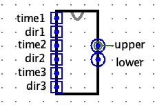
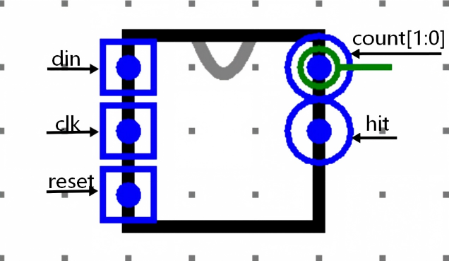
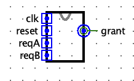

# BUAA CO 2026 P0 题面

## P0_reservation_time

三位同学准备预约同一天的讨论室，每人提出一个时间约束：预约时间不能早于某个时刻，或不能晚于某个时刻。请使用 Logisim 设计一个**组合逻辑电路**，求出同时满足三人要求的公共时间段，并输出其下界和上界。

## 功能说明

讨论室的可预约时间范围为当天的闭区间 。其中， 表示当天结束的时刻，不与  视为同一时刻，本题不涉及跨天预约。

每个约束由一个 **5 位无符号数** `time` 和一个 **1 位方向信号** `dir` 表示。设可预约时刻为 ，方向编码如下：

| `dir` | 约束 | 含义           |
| ----- | ---- | -------------- |
| `0`   |      | 不早于指定时刻 |
| `1`   |      | 不晚于指定时刻 |

三个约束分别由 `time1`、`dir1`，`time2`、`dir2`，`time3`、`dir3` 给出，必须**同时满足**。三个约束没有优先级，输入顺序不影响结果。

输出 `lower` 和 `upper`，表示所有满足约束的时刻构成的完整闭区间 ：

- `lower` 是公共时间段的下界，`upper` 是公共时间段的上界，两个端点均包含在公共时间段内。
- 如果三个约束中没有“不早于”的要求，则下界取默认值 。
- 如果三个约束中没有“不晚于”的要求，则上界取默认值 。

**输入保证：**

- `time1`、`time2`、`time3` 均为 ～ 的整数，不会输入 ～。不同约束中的时间可以相同。
- 三个约束与  的交集一定是具有正长度的时间段，即 。不需要处理交集为空或仅包含一个时刻的情况。

## 输入输出

| 名称    | 功能             | 位宽 | 方向 |
| ------- | ---------------- | ---- | ---- |
| `time1` | 第一个约束的时刻 | 5    | I    |
| `dir1`  | 第一个约束的方向 | 1    | I    |
| `time2` | 第二个约束的时刻 | 5    | I    |
| `dir2`  | 第二个约束的方向 | 1    | I    |
| `time3` | 第三个约束的时刻 | 5    | I    |
| `dir3`  | 第三个约束的方向 | 1    | I    |
| `lower` | 公共时间段的下界 | 5    | O    |
| `upper` | 公共时间段的上界 | 5    | O    |

所有时间输入和输出均按无符号数解释。

## 示例

设三位同学的约束分别为 、、，则输入输出如下，均使用十进制表示：

| 名称    | 值   |
| ------- | ---- |
| `time1` | 8    |
| `dir1`  | 0    |
| `time2` | 20   |
| `dir2`  | 1    |
| `time3` | 12   |
| `dir3`  | 0    |
| `lower` | 12   |
| `upper` | 20   |

三个约束的交集为 ，因此输出 `lower=12`、`upper=20`。

若约束改为 、、，由于没有“不早于”的要求，下界取默认值 ，输出 `lower=0`、`upper=6`。

## 提交要求

- 提交使用 Logisim 搭建的 `.circ` 电路文件，**文件内主电路名为 `main`**。
- 必须严格按照上述端口名称、方向和位宽设计电路。
- 请使用**组合逻辑电路**实现，输出仅由当前输入决定，不依赖历史输入或初始状态。
- **注意：请保证模块的 appearance 与下图一致，否则有可能造成评测错误。注意输入的上下顺序。**

## P0_frame_receiver

设计一个同步有限状态机，逐个接收串行输入 `din`，检测最近输入的数据中是否出现连续比特串 `1101`。每个时钟上升沿采样一次 `din`，当本次采样刚好完成一次匹配时，输出一个时钟周期的检测脉冲。

## 功能说明

- `din` 为 1 位串行输入，每个时钟上升沿采样一个比特。
- 检测目标为连续的 4 位序列 `1101`，输入顺序按照从左到右的时间顺序理解。
- 只有最近 4 次采样依次为 `1、1、0、1` 时，才算检测到一次序列。
- 序列允许重叠。例如输入序列 `1101101` 包含两次 `1101`，应在第 4、7 个采样周期分别产生一次脉冲。
- 未完成匹配时，`hit=0`；完成匹配的同一个时钟周期，`hit=1`，下一个时钟周期自动恢复为 `0`（除非又完成了一次新的匹配）。
- `count[1:0]` 表示累计检测次数：检测到一次后加 1，最大保持为 3；达到 3 后继续检测时，`hit` 仍然正常输出，但 `count` 保持为 `3`。
- `reset` 为同步高有效复位。复位有效的上升沿将状态、`hit` 和 `count` 清零，且该周期不采样 `din`。

## 输入输出

模块名：`main`

| 信号名       | 功能                             | 位宽 | 方向 |
| ------------ | -------------------------------- | ---: | :--: |
| `din`        | 串行输入比特，在时钟上升沿采样   |    1 |  I   |
| `clk`        | 时钟信号                         |    1 |  I   |
| `reset`      | 同步高有效复位信号               |    1 |  I   |
| `count[1:0]` | 已检测到的序列次数，饱和计数到 3 |    2 |  O   |
| `hit`        | 本周期是否刚完成一次 `1101` 检测 |    1 |  O   |

## 示例

以下表格中，每一列对应一个时钟上升沿；复位已提前释放，初始状态为 `S0`。

### 示例 1：基本检测

输入 `1101` 在第 4 个周期完成匹配，因此第 4 个周期 `hit=1`，`count` 变为 1。

| 周期     |    1 |    2 |    3 |    4 |
| -------- | ---: | ---: | ---: | ---: |
| `din`    |    1 |    1 |    0 |    1 |
| 匹配状态 | `S1` | `S2` | `S3` | `s4` |
| `hit`    |    0 |    0 |    0 |    1 |
| `count`  |    0 |    0 |    0 |    1 |

### 示例 2：重叠检测

输入 `1101101` 中，第 1～4 位和第 4～7 位都是 `1101`，所以第 4、7 个周期各产生一次脉冲。

| 周期    |    1 |    2 |    3 |    4 |    5 |    6 |    7 |
| ------- | ---: | ---: | ---: | ---: | ---: | ---: | ---: |
| `din`   |    1 |    1 |    0 |    1 |    1 |    0 |    1 |
| `hit`   |    0 |    0 |    0 |    1 |    0 |    0 |    1 |
| `count` |    0 |    0 |    0 |    1 |    1 |    1 |    2 |

### 示例 3：未匹配序列

输入 `1100` 只匹配到前三位 `110`，最后一个 `0` 不可能完成 `1101`，因此四个周期内 `hit` 始终为 0，`count` 始终为 0。

## 提交要求

- 文件内模块名必须为 `main`。
- 必须使用Moore型有限状态机，计数器和输出均在时钟上升沿更新。
- `reset` 必须实现为同步高有效复位。
- 输入输出端口的名称、方向及位宽必须与上表一致。
- `count` 必须为饱和计数器，不能在达到 `3` 后回绕到 `0`。
- 请保证模块的 appearance 与下图完全一致，否则可能造成评测错误。

## P0_dual_channel_arbiter

同学 A 和 B 共用一台打印机，每次只能由一人打印。请使用 Logisim 设计一个 **Mealy 型有限状态机**，根据两人的申请和此前的打印记录，决定本次由谁使用打印机。

## 功能说明

输入 `reqA`、`reqB` 分别表示 A、B 是否申请打印，`1` 表示申请，`0` 表示不申请。输出 `grant`：`00` 表示无人使用，`01` 表示安排 A，`10` 表示安排 B，不得输出 `11`。

未复位时，每个时钟上升沿，有申请且被 `grant` 选中的人完成一次打印。持续申请并被选中即可多次打印；空闲周期不打断连续打印次数，换人打印后重新计数。

**安排规则**：`grant` 由当前申请和已经完成的打印记录共同决定：

- **两人都不申请**：无人使用，保留此前的打印记录。
- **只有一人申请**：安排此人，无论其此前连续打印过多少次。
- **两人都申请**：若自上次复位后，还没有打印记录，安排 A；否则，若最近使用打印机的人只连续打印过一次，则继续安排此人；若其已连续打印至少两次，则安排另一人。

除异步复位外，打印记录仅在时钟上升沿更新，无人打印时保持不变。

## 复位

`reset` 是高电平有效的**异步复位**信号。`reset=1` 时，立即清空并保持打印记录为空，期间即使出现时钟上升沿，也不计为任何打印。

`reset=1` 时，`grant` 仍按空的打印记录和当前申请计算，如 `reqA=1` 且 `reqB=1` 时，输出 `grant=01`，表示分配给 A。复位释放后，从之后的时钟上升沿开始正常记录打印。

仿真刚开始时，打印记录应记为空。

## 输入输出

| 名称    | 功能                                              | 位宽 | 方向 |
| ------- | ------------------------------------------------- | ---- | ---- |
| `clk`   | 时钟信号，上升沿有效                              | 1    | I    |
| `reset` | 高电平有效的异步复位                              | 1    | I    |
| `reqA`  | A 是否申请打印                                    | 1    | I    |
| `reqB`  | B 是否申请打印                                    | 1    | I    |
| `grant` | 安排结果：`00` 无人使用，`01` 安排 A，`10` 安排 B | 2    | O    |

## 示例

两个示例相互独立，开始前均已复位，表中 `reset` 始终为 `0`。每列给出一次上升沿前的申请和对应的 `grant`，随后在该上升沿完成打印。输出均使用二进制表示。

**示例 1：两人持续申请。**

| 上升沿序号 | 1    | 2    | 3    | 4    | 5    | 6    | 7    | 8    |
| ---------- | ---- | ---- | ---- | ---- | ---- | ---- | ---- | ---- |
| `reqA`     | 1    | 1    | 1    | 1    | 1    | 1    | 1    | 1    |
| `reqB`     | 1    | 1    | 1    | 1    | 1    | 1    | 1    | 1    |
| `grant`    | `01` | `01` | `10` | `10` | `01` | `01` | `10` | `10` |

在初始状态下，两人同时申请，应该分配给A。

**示例 2：单人申请与空闲周期。**

| 上升沿序号 | 1    | 2    | 3    | 4    | 5    | 6    | 7    | 8    | 9    |
| ---------- | ---- | ---- | ---- | ---- | ---- | ---- | ---- | ---- | ---- |
| `reqA`     | 1    | 1    | 1    | 0    | 1    | 0    | 1    | 0    | 1    |
| `reqB`     | 0    | 0    | 0    | 0    | 1    | 1    | 1    | 0    | 1    |
| `grant`    | `01` | `01` | `01` | `00` | `10` | `10` | `01` | `00` | `01` |

前三次仅 A 申请，均安排 A。第 4 次空闲不清除记录，因此第 5 次安排 B。B 连续打印两次后，第 7 次改为 A；第 8 次空闲，第 9 次继续安排只连续打印过一次的 A。

## 提交要求

- 提交使用 Logisim 搭建的 `.circ` 电路文件，**文件内主电路名为 `main`**。
- 必须严格按照上述端口名称、方向和位宽设计电路。
- 请使用 **Mealy 型有限状态机**实现，并提供**异步复位**。
- 模块及其子电路均须使用输入 `clk` 作为唯一时钟，不得使用 Logisim 内置时钟。
- **注意：请保证主电路的外观（Appearance）与下图一致，否则可能造成评测错误。黑色矩形框的大小可以不作要求，但引脚的顺序及相对位置必须正确。**

