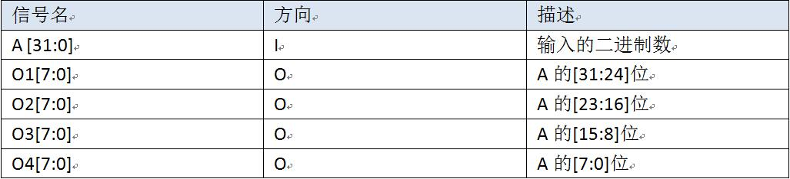

### Verilog部件设计(P1.Q1)

## 前言

在这个部分中，我们的目标是完成Splitter、ALU和EXT的搭建。相信经过之前的学习，大家对这三个组合逻辑部件已经有了一定的了解。在组合逻辑电路中，这是相当简单的例子。我们也希望大家能够从这些简单的例子中，复习使用 Verilog 进行电路设计的一般流程，并且学会如何测试自己所搭建电路的正确性。在本门课程中，Debug 和测试将会是非常重要的技能，希望大家能在课下努力锻炼这种能力。

### 1、Verilog 实现 Splitter

使用 Verilog 搭建一个32位 Splitter , 给定一个32位的二进制数作为输入，将其划分为四个8位的二进制数作为输出。

### 要求：

- 必须严格按照模块的端口定义
- 文件内模块名: splitter