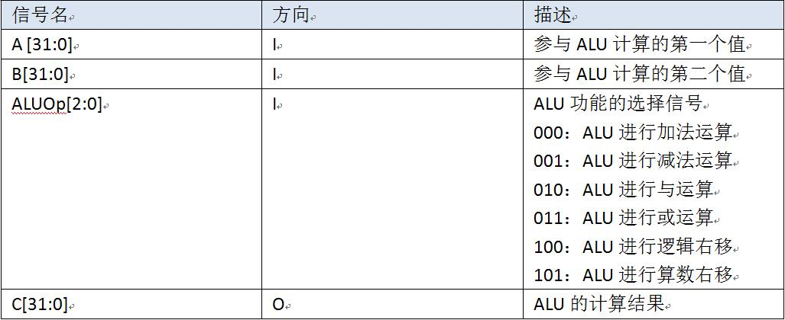
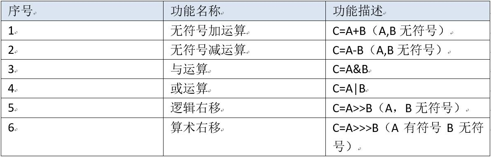

### Verilog部件设计(P1.Q2)

### 2、Verilog 实现 ALU

使用 Verilog 搭建一个 32 位六运算 ALU 并提交。具体模块端口定义如下：

模块功能定义如下：

### 知识复习：

在这里我们需要复习逻辑右移和算术右移的区别：

逻辑右移不考虑符号位，右移一位，左边补零即可。

算术右移需要考虑符号位，右移一位，若符号位为 1 ，在左边补 1 ；否则，补 0 。

例如，8 位二进制数 10111101 分别右移2位。

- 逻辑右移结果为**00**101111
- 算术右移结果为**11**101111

### 提示：

在进行有符号数的相关操作时，应注意 **$signed()** 的使用。若有必要，请参照Verilog教程的语法部分中的相关介绍进行复习。

### 要求：

- 必须严格按照模块的端口定义
- 文件内模块名: alu