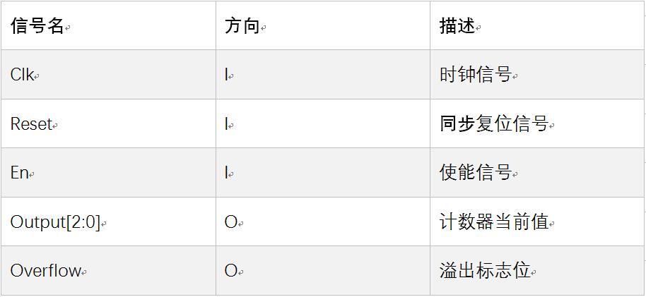
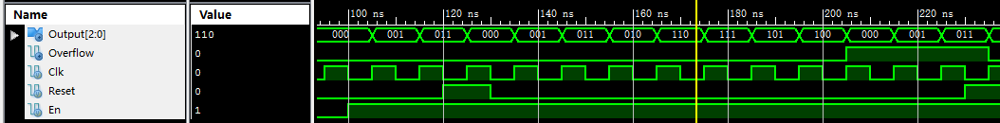
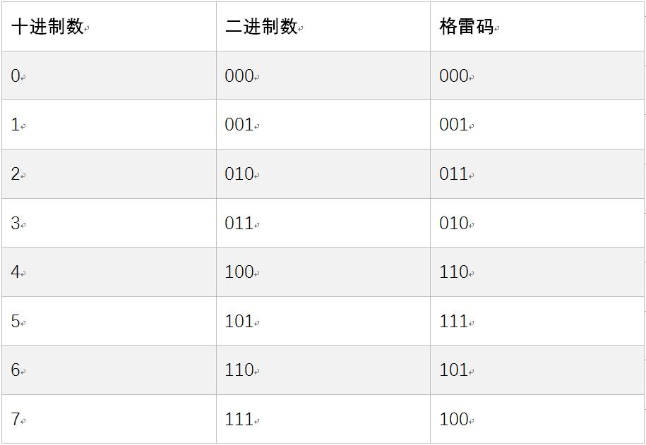

### Verilog时序逻辑(P1.Q4)

## 提交要求

### 1、前言

在完成了 Verilog 组合逻辑部件设计的三道编程题之后，相信大家对于使用 Verilog 进行设计的一般流程和方法已经再次熟悉。现在，我们将进行下一步的挑战——设计包含**时序逻辑**的 Verilog 部件，这也将是我们从组合逻辑部件到之后的**有限状态机**的重要过渡。 在 Verilog 的教程部分，我们曾设计了一个简易的计数器。而我们现在的任务就是设计一个加强版的计数器——格雷码计数器。 如果你对格雷码的定义和优点等知识有所遗忘，这个链接可以帮到你： [格雷码-wikipedia](https://en.wikipedia.org/wiki/Gray_code)

### 2、模块规格

我们的格雷码计数器端口定义如下：

我们要实现的功能如下：

#### 1、 在任意一个时钟上升沿到来的时候，如果复位信号有效，则将计数器清零；

#### 2、 每个时钟上升沿到来的时候，如果使能信号有效，计数器的值+1；

#### 3、 在满足1时，即使2的条件满足，也不必执行2；

#### 4、 计数器初值为0；

#### 5、 当计数器的值在+1后出现溢出的情况时，将会回到零，同时从发生溢出的这个时钟上升沿开始，溢出标志位将会持续输出1，直到计数器被清零为止（其余情况下溢出标志位必须为0）。

示范波形：

为了方便大家设计，这里附上3位格雷码的计数方式：

### 3、要求

- 必须严格按照模块的端口定义
- 文件内模块名: gray