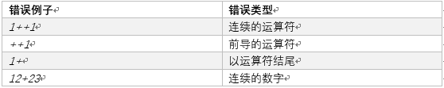
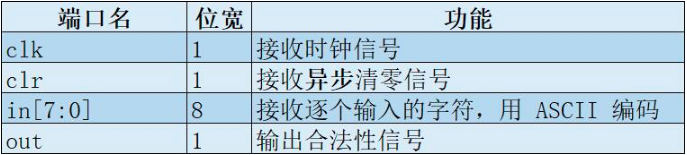
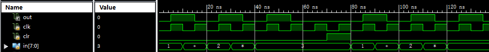

### Verilog表达式状态机(P1.Q5)

## 提交要求

### 1、简介

计算机经常用于处理关于表达式的问题。现在有这样一类表达式F的字符串需要你来验证它们的合法性：

1、表达式F中只含有数字0-9，加号+，乘号*。

2、表达式F可以按如下的规则产生：

a. 单个数字[0-9]是F；
b. 如果**X**是F，**Y**是F，**X+Y**也是F；
c. 如果**X**是F，**Y**是F，**X\*Y**也是F。

排除显而易见的所用符号不合法，所有的非法情况总结如下：

现在，我们需要你用Verilog HDL语言设计一个有限状态机来识别这样的表达式。

### 2、模块规格

模块名：**expr**

### 3、功能要求

每个时钟上升沿，状态机从 in 中读入一个ASCII编码的字符。假设读入的第i个字符为ci，则第n个时钟上升沿时，可以拼出一个字符串:

s=c1c2…cn

我们需要你此时判断 s 是否符合表达式F的定义。假如s符合F的定义，那么 out 应输出1，否则输出0。

另外，每个 clr 上升沿时，请清零状态；如果 clk 的上升沿时 clr 为 1，也需要清零状态。清零后，上面定义的字符串s也应从空串开始计算。如果s当前是空串，out也应输出0。注意，我们不需要你分析表达式的语法和语义，只要判断形式上合法性就可以正确求解。

### 4、输入输出样例

时序规范：总是保证in信号稳定时clk才产生上升沿。

输入：s = **1+2+3+4**
输出：out = 1

输入：s = **1+2+3+**
输出：out = 0

示范波形（输入：s=**1+2\*3**, 清零一周期, s’=**1+2\*3**。时钟周期10ns）：

### 5、提交要求

- 必须严格按照模块的端口定义。
- 文件内模块名: **expr**
- 注意由于 `string` 是 SystemVerilog 的保留字，本题模块名改为 **expr**。