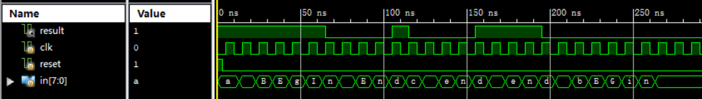

### 语句块检查模拟

现在需要你用Verilog语言编写一个模拟语句块检查的工具。

为了简化要求，**输入由ASCII字母和空格组成**。一个或多个连续出现的字母构成一个单词，单词**不区分大小写**，单词之间由一个或多个空格分隔开。检查工具检查**自复位之后的输入中**，begin和end是否能够匹配。

匹配规则类似括号匹配：一个begin只能匹配一个end，但是一个匹配的begin必须出现在对应的end之前；允许出现嵌套；最后若出现不能按上述规则匹配的begin或end，则匹配失败。

输入的读取在**时钟上升沿**进行。

匹配示例：Hello world，begin comPuTer orGANization End。

不匹配示例：eND，beGin study。

**建议大家认真查看示例波形。**

模块端口定义如下：

| 信号名  | 方向 | 描述                                             |
| :------ | :--- | :----------------------------------------------- |
| clk     | I    | 时钟信号                                         |
| reset   | I    | 异步复位信号（高电平有效，复位时将输入记录清空） |
| in[7:0] | I    | 当前输入字符的ASCII码                            |
| result  | O    | 当前输入是否能够完成begin和end的匹配             |

## 提交要求

- 必须严格按照模块的端口定义
- 文件内模块名：BlockChecker
- **模块内不要包含任何$display语句** ，以防造成误判
- 我们保证在使用模块前进行复位
- **保证输入的单词数和单词长度均小于2^32**

## 示例波形

