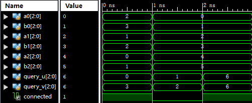
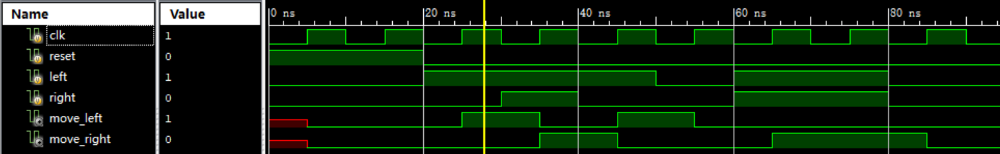
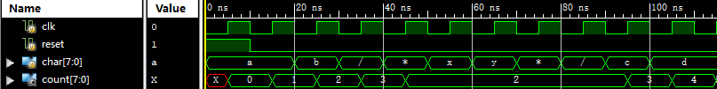

## P1_connectivity

# 接线连通检测

## 1、简介

计小组正在检查一块实验板。板上有 8 个接线柱，编号为 0 到 7，接线柱之间原本互不连接。现在，他使用 3 根导线连接其中的一些接线柱，每根导线的两端各接在一个接线柱上。

两个接线柱既可以通过一根导线直接连通，也可以通过其他接线柱和多根导线间接连通。例如，一根导线连接 0 和 1，另一根连接 1 和 2，那么 0、1、2 就相互连通。如果无法沿导线从一个接线柱到达另一个接线柱，则它们不连通。

请你设计一个组合逻辑模块，根据这 3 根导线两端的接线柱编号，判断指定的两个接线柱是否连通。三根导线的两端分别由 `(a0, b0)`、`(a1, b1)`、`(a2, b2)` 给出，待查询的两个接线柱编号分别为 `query_u` 和 `query_v`。若它们连通，输出 `connected = 1'b1`；否则输出 `connected = 1'b0`。

额外说明：

1. 每个接线柱都与自身连通，没有连接任何导线的接线柱只与自身连通。
2. 允许一根导线的两端接在同一个接线柱上，此时该导线不影响任何连通性。
3. 三根导线的排列顺序，以及任意一根导线两端的顺序，均不影响连通性。

## 2、模块规格

模块名：`connectivity`。

| 信号名       | 方向 | 描述                                         |
| ------------ | ---- | -------------------------------------------- |
| a0[2:0]      | I    | 第一根导线一端的接线柱编号                   |
| b0[2:0]      | I    | 第一根导线另一端的接线柱编号                 |
| a1[2:0]      | I    | 第二根导线一端的接线柱编号                   |
| b1[2:0]      | I    | 第二根导线另一端的接线柱编号                 |
| a2[2:0]      | I    | 第三根导线一端的接线柱编号                   |
| b2[2:0]      | I    | 第三根导线另一端的接线柱编号                 |
| query_u[2:0] | I    | 待查询的第一个接线柱编号                     |
| query_v[2:0] | I    | 待查询的第二个接线柱编号                     |
| connected    | O    | 两个接线柱是否连通，1 表示连通，0 表示不连通 |

## 3、输入输出样例

下图中的接线柱编号均为十进制。三个时间段分别对应三组独立输入，组与组之间不累积连接关系。

如图，第一组中，接线柱 0 可以沿导线经过 1、2 到达 3，因此输出 1；第二组中，接线柱 1 和 2 不连通，输出 0；第三组查询接线柱 6 与自身是否连通，即使它没有连接导线，也输出 1。

## 4、提交要求

- 必须严格按照模块的端口名称和方向定义。
- 文件内模块名：`connectivity`。
- 模块内不要包含任何 `$display` 语句，以防造成误判。

## P1_direction_priority

# 后按方向优先

## 1、简介

你需要设计一个游戏方向键冲突处理器。玩家使用左、右方向键控制角色水平移动；当两个方向键同时按下时，按照 **“最后按下的方向优先”** 规则决定角色的移动方向。

每当时钟上升沿到达时，模块采样当前的  和 ，并按照以下规则更新  和 ：

1. 当  为 `1'b1` 时，执行同步复位：清除保存的历史按键信息，并令  和  均为 `1'b0`。
2. 当当前 、 分别为 `1'b0`、`1'b0` 时，角色停止移动。
3. 当当前 、 分别为 `1'b1`、`1'b0` 时，角色向左移动。
4. 当当前 、 分别为 `1'b0`、`1'b1` 时，角色向右移动。
5. 当当前  和  均为 `1'b1` 时，根据上一周期的按键信息决定优先方向：
   - 若上一周期只有左键按下，说明右键是本周期新按下的方向，因此角色向右移动；
   - 若上一周期只有右键按下，说明左键是本周期新按下的方向，因此角色向左移动；
   - 若上一周期左右键均已按下，则保持上一周期的移动方向；
   - 若上一周期左右键均未按下，说明两个方向键在本周期同时按下，规定右方向优先，因此角色向右移动。

任何情况下，输出信号  与  都不会同时为 `1'b1`。

## 2、模块规格

模块名：direction_priority

| 信号名     | 方向 | 描述                                 |
| ---------- | ---- | ------------------------------------ |
| clk        | I    | 时钟信号                             |
| reset      | I    | 同步复位信号，高电平有效             |
| left       | I    | 左方向键状态，高电平表示按下         |
| right      | I    | 右方向键状态，高电平表示按下         |
| move_left  | O    | 左移信号，高电平表示当前周期向左移动 |
| move_right | O    | 右移信号，高电平表示当前周期向右移动 |

## 3、数据范围

保证测试开始时会先进行复位，并保证复位期间  和  均为 `1'b0`。保证每个时钟周期内  与  的电平保持稳定。

## 4、输入输出样例

如图，

1. 复位结束后的第 1 个周期，、 分别为 `1'b1`、`1'b0`，因此  为 `1'b1`。
2. 第 2 个周期， 由 `1'b0` 变为 `1'b1`，而  仍为 `1'b1`，因此右方向成为后按下的方向， 为 `1'b1`。
3. 第 3 个周期， 变为 `1'b0` 而  仍为 `1'b1`，因此恢复向左移动。
4. 第 4 个周期左键也松开，角色停止移动。
5. 第 5 个周期， 和  同时变为 `1'b1`，因此按照约定选择右方向
6. 第 6 个周期两个方向键继续保持按下，因此继续保持向右移动。

## 5、提交要求

- 必须严格按照模块的端口名称和方向定义。
- 文件内模块名：direction_priority。
- 模块内不要包含任何 `$display` 语句，以防造成误判。

## P1_comment_filter

# 简易注释过滤器

## 1、简介

程序中常用 `/* ... */` 表示注释。请使用 Verilog 实现一个简易注释过滤器，串行接收字符，实时输出自上次复位以来，已读入文本去掉注释后剩余的字符数。

## 2、过滤规则

`/` 和 `*` 的 ASCII 码分别为 `8'h2F`（十进制 47）和 `8'h2A`（十进制 42）。除这两个值外，所有 8 位输入值均作为普通字符处理，无需检查是否为合法 ASCII。

从左到右处理输入文本，规则如下：

1. 在注释外，连续出现的两个字符 `/*` 表示注释开始。
2. 进入注释后，随后第一次出现的 `*/` 表示注释结束。不支持嵌套：在注释内不再识别新的开始标记，只查找结束标记。
3. 注释的开始标记、结束标记及内部的所有字符均不计入结果。开始和结束标记不能共用字符。例如 `/**/` 是完整注释，而 `/*/` 还没有结束注释。
4. 本题只识别块注释，不识别 `//` 行注释，也不对引号或转义字符进行特殊处理。

**统计结果只根据当前已经读入的字符确定，不等待后续字符。** 为明确注释标记尚未完整输入时的行为，规定如下：

- 在注释外读到 `/` 时，先将它作为一个普通字符计数。
- 若紧接着读到 `*`，则确认刚才的 `/` 和本次的 `*` 组成开始标记 `/*`。此时应扣除此前已计入的那个 `/`，本次的 `*` 不计数，并进入注释。
- 进入注释后，直到读完结束标记 `*/` 为止，读入的字符均不增加计数。

设从上次复位到最近一次上升沿已经读入的文本，按上述规则处理后的非注释字符数为 ，输出为：

即保留低 8 位。例如，读取到 260 个注释外字符时，输出为 4。

## 3、模块规格

模块名：`comment_filter`。

**本题要求使用 Moore 型状态机。** 计数值也是状态的一部分，输出 `count` 仅由当前已寄存的状态决定。输入字符 `char` 的变化不会立即改变输出；只有在时钟上升沿采样输入并更新状态后，`count` 才相应更新。

| 信号名     | 方向 | 描述                                          |
| ---------- | ---- | --------------------------------------------- |
| clk        | I    | 时钟信号，在上升沿采样输入并更新状态          |
| reset      | I    | 同步复位信号，高电平有效                      |
| char[7:0]  | I    | 当前输入字符的编码                            |
| count[7:0] | O    | 从上次复位到当前采样的有效字符数，保留低 8 位 |

每个时钟上升沿按以下优先级处理：

1. 若 `reset = 1`，清空此前的输入记录和内部状态，并将 `count` 置为 0，且本次不接收 `char` 中的字符。复位后默认在注释外。
2. 否则，接收 `char` 中的一个字符，按过滤规则更新内部状态和 `count`。

保证开始输入前先进行同步复位。

## 4、输入输出样例

先进行同步复位，随后保持 `reset = 0`，依次输入 `ab/*xy*/cd`。

如图，读到第一个 `/` 时先计数，`count` 变为 3；下一拍读到 `*` 时确认注释开始，扣除此前计入的 `/`，`count` 回到 2。注释结束后继续统计 `c`、`d`，最终输出 4。

## 5、提交要求

- 必须严格按照模块的端口名称和方向定义。
- 文件内模块名：`comment_filter`。
- 模块内不要包含任何 `$display` 语句，以防造成误判。
