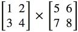

使用MIPS汇编语言编写一个具有矩阵相乘功能的汇编程序(不考虑延迟槽)。

## **具体要求**

- 首先读取方形矩阵的阶数n，然后再依次读取第一个矩阵（n行n列）和第二个矩阵（n行n列）中的元素。

- 两个矩阵的阶数相同，我们提供的测试数据中0<n≤8,每个矩阵元素是小于10的整数。

- 最终将计算出的结果输出，每行n个数据，每个数据间用空格分开。评测机会自动过滤掉行尾空格以及最后的回车。

- 请使用syscall结束程序：

  ```none
  li $v0,10
  syscall
  ```

## **样例**

****

比如我们想要计算上面这两个矩阵相乘的结果，我们会给出以下输入：

```none
2
1
2
3
4
5
6
7
8
```

正确的输出应该是：

```none
19 22
43 50
```

## **提交要求**

- 请勿使用`.globl main`。
- 不考虑延迟槽。
- 只需要提交.asm文件。
- 程序的初始地址设置（Mars->Settings->Memory Configuration）为**Compact,Data at Address 0**。

任务时间：2026/10/19 23:00-2026/10/25 22:00

提交要求

题型：MARS 汇编

提交文件：*.asm

提交后需等待5分钟，方可再次提交。