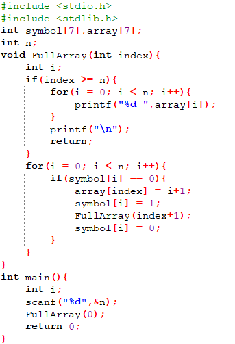

## 全排列生成

实现满足下面功能的汇编程序：

1. 使用mips实现全排列生成算法。

2. 以0x00000000为数据段起始地址。

3. 输入一个小于等于6的正整数，求出n的全排列，并按照字典序输出。

4. 每组数据最多执行500,000条指令。

5. 请使用syscall结束程序：

6. ```none
   li $v0,10
   syscall
   ```

## 输入格式

只输入一行，输入一个整数n **(0<n<=6)**

## 输出格式

按照字典序输出n!行数组，每行输出n个数字，数字之间以空格隔开，每行最后一个数字后可以有空格。

## C代码提示



## 输入样例

```
4
```

## 输出样例

```
1 2 3 4
1 2 4 3
1 3 2 4
1 3 4 2
1 4 2 3
1 4 3 2
2 1 3 4
2 1 4 3
2 3 1 4
2 3 4 1
2 4 1 3
2 4 3 1
3 1 2 4
3 1 4 2
3 2 1 4
3 2 4 1
3 4 1 2
3 4 2 1
4 1 2 3
4 1 3 2
4 2 1 3
4 2 3 1
4 3 1 2
4 3 2 1
```

## 提交要求

1. **请勿使用** `.globl main`
2. 不考虑延迟槽
3. 只需要提交.asm文件。
4. 程序的初始地址设置为**Compact,Data at Address 0**。