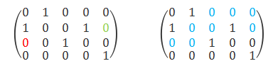

## 01迷宫

1. 在mips教程部分我们出了一道挑战题留给大家探索——哈密顿回路，哈密顿回路问题是一道npc的问题，需要使用深度优先探索算法进行求解。而我们今天课下测试也准备了一道挑战性测试题：使用深度优先探索算法求解01迷宫的逃离路线个数（这道题通过与否不作为是否能参加P2课上的条件）。

## 逃跑路线



1. 左图表示的是一个4*5的01矩阵，这个矩阵就是一个01迷宫。
2. 如左图，以红色0作为起点，绿色0作为终点，每一次行进只能选择上下左右中值为0且未走过的位置，满足上述条件的路线，即为一条迷宫逃跑路线。如右图中，蓝色的路线即为一条逃跑路线。

## 题目描述

1. 使用mips实现01迷宫路线数目计算。
2. 以0x00000000为数据段起始地址。
3. 输入一个n*m的01矩阵作为01迷宫，并给定他的起点与终点，求出他不同逃跑路线的数目（不同逃跑路线中可以有相同的部分，但是不能完全相同）。
4. 每组数据最多执行5,000,000条指令。

## 输入格式

前两行输入两个整数n和m（n、m均为正整数并且小于等于7），分别代表01矩阵行数和列数。接下来的n*m行，每行输入1个整数（0或1），对应着01矩阵各个元素值(第i*m+j个整数为矩阵的第（i+1）行第j个元素，即一行一行输入)。接下来的四行分别代表迷宫的起点和终点，每行一个整数，分别代表起点与终点行数和列数。

## 输出格式

只输出一个整数，代表逃跑路线的数目。

## 输入样例

```
4
5
0
0
1
0
0
1
0
0
0
1
1
0
1
0
1
1
0
0
0
0
1
1
4
5
```

## 输出样例

```
2
```

## 提交要求

1. **请勿使用**`.globl main`
2. 不考虑延迟槽
3. 只需要提交.asm文件。
4. 程序的初始地址设置为**Compact,Data at Address 0**。