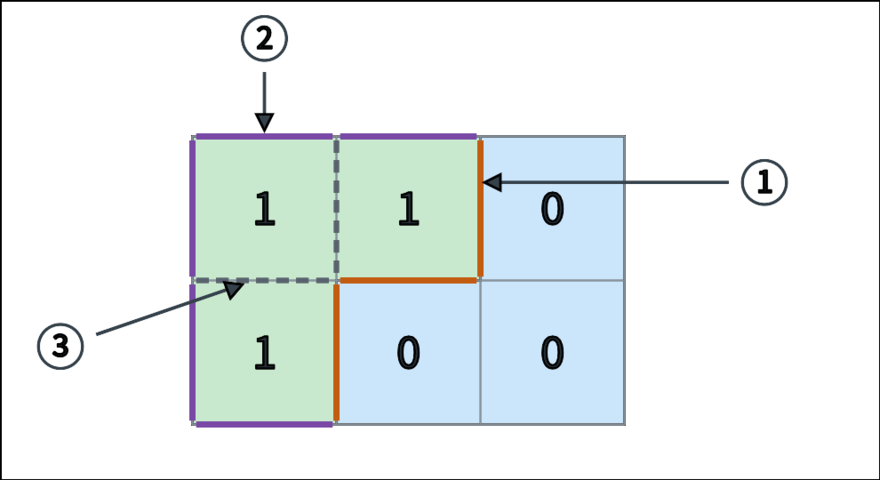

# Island Perimeter

## 任务

给定一个由 `0` 和 `1` 组成的  网格，其中 `1` 表示陆地，`0` 表示水域。每个格子都是边长为  的正方形。

请使用 MIPS 汇编语言计算所有陆地的总周长（不考虑延迟槽）。

## 具体要求

### 周长定义

对于一个陆地格，它的每条边按以下规则计算：

- 如果边的另一侧是水域，该边对总周长贡献 。
- 如果边的另一侧超出网格范围，该边对总周长贡献 。
- 如果边的另一侧也是陆地，该边不计入总周长。

网格可以包含多个岛屿，输出所有陆地的总周长即可。陆地内部被包围的水域与陆地之间的边界也计入总周长。

### 输入

第一行输入一个整数 ，表示网格行数。

第二行输入一个整数 ，表示网格列数。

接下来输入  个整数，按从上到下、从左到右的顺序给出网格内容，每个整数均为 `0` 或 `1`。

**输入中的所有整数由用换行符分隔，每个整数单独占一行。**

保证 。

### 输出

输出一个整数，表示所有陆地的总周长。

如果网格中没有陆地，输出 `0`。

### 提示

可以先认为每个陆地格贡献  条边，再对每对共用一条边的相邻陆地格减去 。只检查每个陆地格的右侧和下侧，即可避免重复处理同一对相邻格子。检查相邻格子前，注意判断是否超出网格范围。

## 示例

### 输入样例1

```none
2
3
1
1
0
1
0
0
```

### 输出样例1

```none
8
```

### 说明



如图所示，绿色格子中的 `1` 表示陆地，蓝色格子中的 `0` 表示水域。图中标出了所有与陆地有关的边，箭头 ①②③ 各指向其中一个例子；细网格线仅用于表示格子划分。

- **① 橙色实线：另一侧是水域**。共  条，每条对总周长贡献 。
- **② 紫色实线：另一侧超出网格范围**。共  条，每条对总周长贡献 。
- **③ 灰色虚线：另一侧也是陆地**。共  条公共边，每条只标记一次，不计入总周长，贡献为 。

因此，该网格的总周长为 。

### 输入样例2

```none
3
3
1
1
1
1
0
1
1
1
1
```

### 输出样例2

```none
16
```

### 输入样例3

```none
2
2
1
0
0
1
```

### 输出样例3

```none
8
```

## 提交要求

- 请勿使用 `.globl main`。
- 不考虑延迟槽。
- 只需要提交 `.asm` 文件。
- 程序的初始地址设置（MARS → Settings → Memory Configuration）为 **Compact, Data at Address 0**。
- 步数限制为 200,000。
- 请使用 syscall 结束程序：

```mips
li $v0, 10
syscall
```

# 由遍历序列重建二叉树（TreeRebuild）

## 任务

给定一棵二叉树（节点权值互不相同）的**前序遍历序列**  与**中序遍历序列** ，请使用 MIPS 汇编语言编写程序，利用递归方法重建这棵二叉树，并输出它的**后序遍历序列**。

前序、中序、后序遍历的定义如下：

1. 前序遍历：先访问根节点，再递归遍历左子树，最后递归遍历右子树；
2. 中序遍历：先递归遍历左子树，再访问根节点，最后递归遍历右子树；
3. 后序遍历：先递归遍历左子树，再递归遍历右子树，最后访问根节点。

重建的关键性质：前序遍历的**第一个元素**一定是当前子树的根；在中序遍历中，该根元素把序列分成左右两部分，左侧属于左子树，右侧属于右子树，由此可确定左右子树各自的规模。

## 具体要求

### 输入

第一行：一个整数 ，表示二叉树的节点数，满足 。

随后  行：第  行输入一个整数 ，为前序遍历序列的第  个元素。

再随后  行：第  行输入一个整数 ，为中序遍历序列的第  个元素。

**保证**  与  恰好是同一棵二叉树的合法前序、中序遍历序列，且所有节点权值互不相同。权值满足 。

### 输出

输出  行，依次为重建所得二叉树的后序遍历序列，第  行输出后序遍历的第  个元素。

程序结束时请使用：

```mips
li $v0, 10
syscall
```

步数限制为 200,000。

## 示例

### 输入样例1

```none
6
1
2
4
5
3
6
4
2
5
1
6
3
```

### 输出样例1

```none
4
5
2
6
3
1
```

该样例重建出的二叉树为：根节点为 1，左子树根为 2（其左孩子 4、右孩子 5），右子树根为 3（其左孩子 6）。其后序遍历序列为 `4 5 2 6 3 1`。

### 输入样例2

```none
5
1
2
3
4
5
1
2
3
4
5
```

### 输出样例2

```none
5
4
3
2
1
```

该样例是一棵只有右子树的链状二叉树（每个节点均无左孩子），递归深度达到 ，用于检验程序在最坏情况下的正确性。

## 提交要求

- 请勿使用`.globl main`
- 不考虑延迟槽
- 只需要提交 .asm 文件
- 程序的初始地址设置（ Mars->Settings->Memory Configuration ）为 **Compact, Data at Address 0**

## 参考代码

```c
#include <stdio.h>

#define MAXN 205

int n;
int pre[MAXN];
int in[MAXN];

void build(int pl, int pr, int il, int ir) {
    if (pl > pr) {
        return;
    }

    int root = pre[pl];

    // Locate the root in the inorder sequence
    int k = il;
    while (in[k] != root) {
        k++;
    }

    int leftSize = k - il;

    // Left subtree
    build(pl + 1, pl + leftSize, il, k - 1);
    // Right subtree
    build(pl + leftSize + 1, pr, k + 1, ir);

    printf("%d\n", root);
}

int main() {
    scanf("%d", &n);

    for (int i = 0; i < n; i++) {
        scanf("%d", &pre[i]);
    }
    for (int i = 0; i < n; i++) {
        scanf("%d", &in[i]);
    }

    build(0, n - 1, 0, n - 1);

    return 0;
}
```

# K_Palindrome

## 任务

使用 MIPS 汇编语言编写程序，计算将数组的各个分组分别变成回文序列所需的最少删除次数（不考虑延迟槽）。

## 具体要求

### 分组回文

给定一个下标从  开始、长度为  的正整数数组 ，以及一个正整数 。

对于每个 ，将原数组中下标为  且小于  的元素按原顺序提取出来，组成第  组。

一次操作可以删除某一组中的一个元素，其余元素的相对顺序保持不变。你需要使每一组都成为回文序列，并求所有组所需删除次数之和的最小值。

回文序列是指从左向右与从右向左读取完全相同的序列。例如，`[2, 5, 2]`、`[4, 4]` 和 `[7]` 都是回文序列，空序列也视为回文序列。

**分组只进行一次，始终依据原数组下标。删除元素不会导致其他元素重新分组。**

### 输入格式

- 第 1 行输入一个整数 ，表示数组长度，。
- 第 2 行至第  行，每行输入一个整数，为数组的一个元素，。
- 第  行输入一个整数 ，。

### 输出格式

输出一个整数，表示最少删除次数。

### 规定

- 步数限制为 200,000。
- 使用 syscall 结束程序：

```mips
li $v0, 10
syscall
```

## 样例1

### 输入

```none
8
1
4
2
5
3
4
1
6
2
```

### 期望输出

```none
2
```

### 说明

两组分别为 `[1, 2, 3, 1]` 和 `[4, 5, 4, 6]`。

第一组删除 `2` 或 `3`，第二组删除末尾的 `6`，共删除两个元素。

## 样例2

### 输入

```none
5
1
2
3
4
5
1
```

### 期望输出

```none
4
```

## 样例3

### 输入

```none
3
7
8
9
3
```

### 期望输出

```none
0
```

## 提交要求

- 请勿使用 `.globl main`。
- 不考虑延迟槽。
- 只需要提交 `.asm` 文件。
- 程序的初始地址设置（MARS → Settings → Memory Configuration）为 **Compact, Data at Address 0**。

## 参考代码

```c
#include <stdio.h>
#define MAX_N 30

int minPalindromeDeletes(const int *subseq, int m) {
    if (m <= 1) return 0;
    int dp[MAX_N][MAX_N];
    for (int i = 0; i < m; i++) dp[i][i] = 0;

    for (int len = 2; len <= m; len++) {
        for (int l = 0; l + len <= m; l++) {
            int r = l + len - 1;
            if (subseq[l] == subseq[r]) {
                dp[l][r] = (len == 2) ? 0 : dp[l + 1][r - 1];
            } else {
                int a = dp[l + 1][r];
                int b = dp[l][r - 1];
                dp[l][r] = (a < b ? a : b) + 1;
            }
        }
    }
    return dp[0][m - 1];
}

int kPalindrome(const int *arr, int n, int k) {
    int ans = 0;
    int subseq[MAX_N];
    for (int r = 0; r < k; r++) {
        int m = 0;
        for (int j = r; j < n; j += k) {
            subseq[m++] = arr[j];
        }
        ans += minPalindromeDeletes(subseq, m);
    }
    return ans;
}

int main(void) {
    int n, k, arr[MAX_N];
    scanf("%d", &n);
    for (int i = 0; i < n; i++) scanf("%d", &arr[i]);
    scanf("%d", &k);
    printf("%d\n", kPalindrome(arr, n, k));
    return 0;
}
```