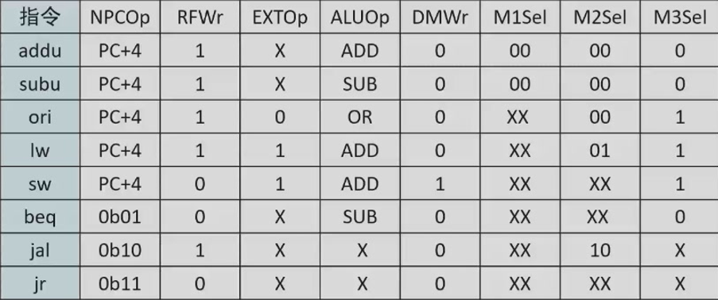

测试机器码里面的所有指令：ori sub add beq lui sw lw nop

`nop` 为空指令，不进行任何有效行为

# IM

指令存储器

输入：一个地址

输出：对应地址的数据

内部实现：ROM

> 读取的文件开头为：v2.0 raw
>
> 由于一条指令为32位，所以Data Bit Width为32
>
> 地址空间起点是0x0000_0000，而非0x0000_3000，所以我们应该先减去0x0000_3000
>
> 并且ROM里面相邻两个32位的数据，地址只相差1而不是4，所以我们需要除以4
>
> ROM存储空间最大是24位，所以我们需要舍弃掉一些地址空间

地址范围：0x0000_3000 ~ 0x0000_6fff

机器码拆分：26-31     OpCode

21~25    rs

16~20    rt

11~15      rd

6 ~ 10     shamt

0~5       Funct

# PC

用寄存器来实现，有异步复位的功能，其中复位的起始值需为0x0000_3000

直接接收来自NPC计算出来的下一个指令地址的值即可

# NPC

程序来计算下一条指令的地址，默认情况下，指向PC + 4，有跳转类指令时除外

所有已包含指令中，只有beq涉及到了指令的跳转

输入值：PC    当前指令指向的地址

imm16    beq指令的相对跳转的距离，采用符号扩展为32位，并且需要向左移两位

NPC_Sel    选择是直接往后走，还是分支跳转指令

zero    表示分支跳转指令是否成立

输出：NPC    表示下一条指令的地址

# GRF

具有异步复位功能，复位初始值为0，寄存器总数是32个，0号寄存器的值始终为0

输入接口：A1  RD1输出的寄存器的位置

A2     RD2输出的寄存器的位置

A3      WD写入的寄存器的位置

WD      要写入的数据内容

clk      时钟周期

reset      异步复位信号

WE         写入使能信号，防止意外写入

输出接口：RD1         输出A1位置的寄存器的值

RD2          输出A2位置的寄存器的值

# Controller

控制信号取值矩阵

输入接口：OpCode 26~31 bit

Funct   0~5 bit

需要比较完OpCode 之后，才允许比较Funct

输出：NPC_Sel  决定下一个指令地址的计算方式

RFWr   是否允许寄存器堆的读写

type    当前指令的类型，供ALU消费

# ALU

支持算法：减，加，判零，或

输入：operand1:    计算数1

operand2： 计算数2

type：运算的具体类型

输出：result:     计算出来的结果

zero:      计算两个操作数是否相等，相等则zero = 1

# EXT

输入16bit数据，按需进行符号扩展和零扩展

输入：imm16  16bit立即数

EXTOp    为0时是0扩展，为1时是符号扩展

输出：imm32    32bit立即数

# DM

位宽32bit

地址空间大小：3072

地址范围0x0000_0000~0x0000_2fff

输入：Addr     要写入的地址（这里同样也需要右移两位）

WD：要写入对应地址的数据

WE：是否允许值的写入

clk：时钟

reset：异步复位，复位初始值为0

输出：Data：当前位置所输出的值