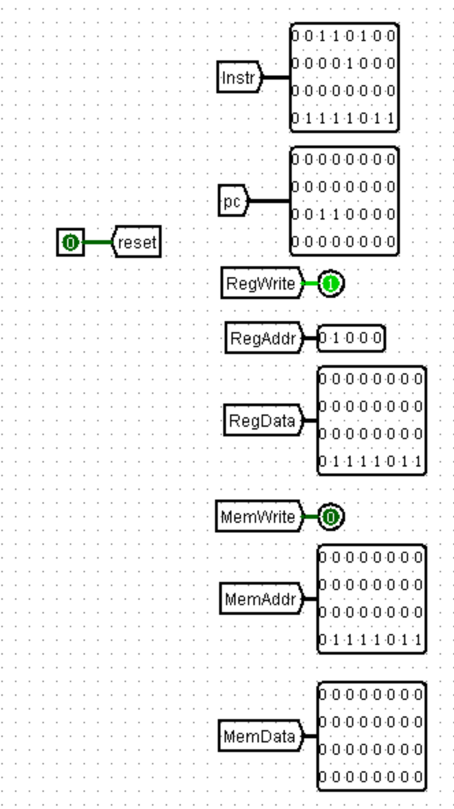
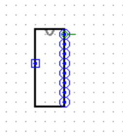
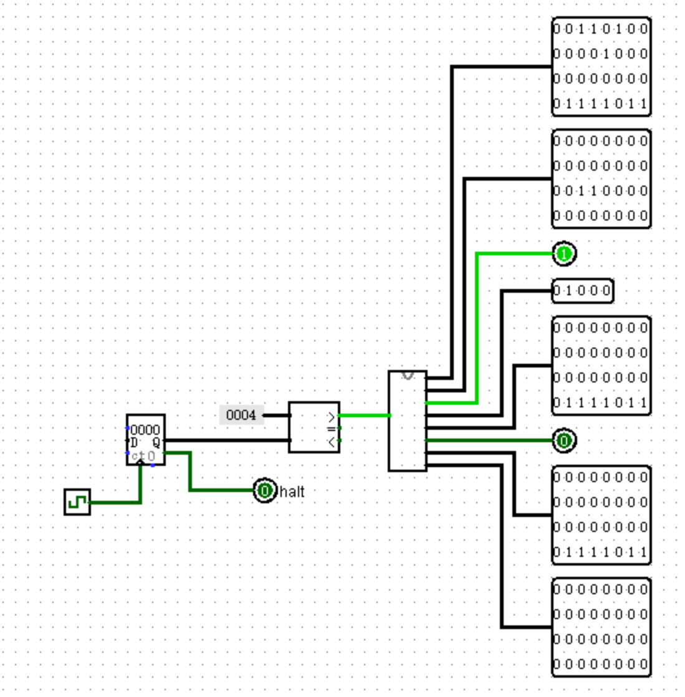

# CPU 电路源文件提交入口

## 评测说明

为了鼓励同学们编写自己的测试程序，对于评测机使用的评测程序，我们仅给出第一个测试数据的机器码来进行本地测试，测试代码机器码见附件。

评测机将通过如下读取以下信号来对正确性进行判断，因此请保证在顶层视图中有如下输出信号

- Instr: 32 位指令信号
- pc: 32 位程序计数器信号
- RegWrite: GRF 写入控制信号
- RegAddr: GRF 5 位写入地址
- RegData: GRF 32 位写入数据
- MemWrite: DM 写入控制信号
- MemAddr: DM 32 位写入地址
- MemData: DM 32 位写入数据

我们建议你使用 Tunnel 将相关信号引出，如下图所示。但无论你使用什么方法，请确保输入输出的相对位置、位宽与下图相同。

## 注意事项

- 顶层模块名称： **main**
- 子电路外观：

- 测试电路如下图所示：

- 本实验允许使用 Logisim 所有的内置元器件。
- 请提交单一一个 .circ 文件，评测机会自动在你的 ROM 中加载机器码进行测试。
- 提交自动评测的时间间隔为 5 分钟，请自行做好测试再提交评测机评测。
- 本次实验课下测试部分仅提供弱测，其返回的错误信息有一定的参考价值，但请不要完全依赖！
- **参加课上测试条件：**
  - **通过本窗口的所有测试点。**
  - **提交 CPU 设计文档。**

# CPU 设计文档及思考题提交入口

## 注意事项

- 设计文档应包含**设计草稿、测试方案与思考题**等内容。
- 推荐使用 Markdown 撰写设计文档，Markdown 教程可参考[菜鸟教程](https://www.runoob.com/markdown/md-tutorial.html)。

## 思考题汇总

1. 上面我们介绍了通过 FSM 理解单周期 CPU 的基本方法。请大家指出单周期 CPU 所用到的模块中，哪些发挥状态存储功能，哪些发挥状态转移功能。
2. 现在我们的模块中 IM 使用 ROM， DM 使用 RAM， GRF 使用 Register，这种做法合理吗？ 请给出分析，若有改进意见也请一并给出。
3. 在上述提示的模块之外，你是否在实际实现时设计了其他的模块？如果是的话，请给出介绍和设计的思路。
4. 事实上，实现 `nop` 空指令，我们并不需要将它加入控制信号真值表，为什么？
5. 阅读 MIPS 单元“6.1 测试程序设计”一节中给出的测试样例，评价其强度（可从各个指令的覆盖情况，单一指令各种行为的覆盖情况等方面分析），并指出具体的不足之处。