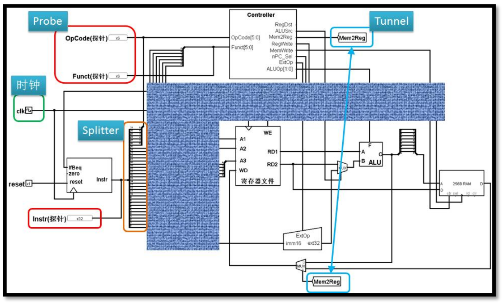
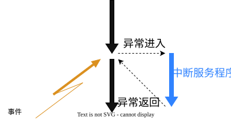

# 异常处理

## 异常处理简介

经过 P3, P4 部分的学习，我们已经理解并搭建了一个简单的 MIPS 单周期处理器。这个处理器能进行 add, sub, lui 等逻辑操作，能实现 sw, lw 等访存操作，也能执行分支、跳转指令。看起来，在现有的指令集上，我们的 CPU 似乎已经具有了完善的功能，能应付运行中发生的一切情况了。然而，事实果真如此吗？

或许细心的同学已经注意到，在课程组给出的 MIPS-C 指令集中，add, sub等指令的操作部分存在溢出判断：若算术溢出，则产生异常 SignalException(IntegerOverflow) ；而lw, sw 等指令的约束中，也指出地址不对齐时将“产生地址错误异常”。这些异常代表着什么？CPU 的异常处理功能又该如何实现？这就是我们在本 Project 中需要完成的任务。

# 什么是异常

## 异常的认识

正如程序员在编写程序时，为了保证程序的鲁棒性，需要对输入数据的各种情况进行处理。CPU 在执行指令时，也需考虑可能遇到的指令出错情况。例如 lw 指令地址未对齐，或者 add 指令发生算术溢出，更或者，输入的指令根本就不属于 CPU 能处理的指令集，无法被正常识别、执行。 指令不遵循指令集的约束，引发了错误的执行结果，便是异常。引发异常的这条指令被称为“犯罪指令”。

显然，到 P4 为止，我们搭建的 CPU 是不能正确的处理这些异常的。有些异常发生后无法被正确识别，导致错误的执行结果被保存；有些异常发生后，则会引发系统的错误或崩溃。

### 异常产生的原因

接下来，我们全面的考虑一下，P4 中实现的单周期 CPU 在执行指令时，可能会出现哪些异常。



仍以在 P3 中展示过的参考图为例。

执行指令的第一步，是要根据当前指令的 PC 值取出指令。若 PC 地址没有字对齐或超出了合法范围，则产生取指异常。若 PC 满足字对齐且在合法范围内，取出的指令进入译码器中，若指令是一条不在指令集中的非法指令，则会在此时被识别出。之后，若指令能被正常识别，在执行阶段，可能在 ALU 中引发溢出相关异常，这包括 add, sub 指令对应的溢出异常以及 sw, lw 指令在计算地址时溢出导致的存数或取数异常。即使也没有引起异常，访存指令还可能因为地址没有对齐或者地址越界而引发异常。

此外，还需考虑一种异常情况：syscall指令。

## syscall 指令

关于 syscall 指令的作用，相信同学们在 MIPS 学习中已经掌握。程序执行中，有时需要执行输入、输出等操作。这些操作单凭 CPU 无法完成，还需要计算机其他部件的配合。此时，CPU 通过 syscall 指令将向操作系统发送信号，请求执行系统调用。之后，操作系统会根据寄存器 `$v0` 中的值确定执行哪一种系统调用。这与发生异常的情况颇为相似：执行到 syscall 指令后，CPU 不继续执行指令流中的下一条指令，而应先针对当前情况做一些“特殊处理”。因此，虽然 syscall 指令并非由错误产生，我们依然将其视为一种异常，用同样的方法进行处理。

在本次任务中，我们也将通过异常处理的方式模拟对 Syscall 指令的处理。

这种针对异常进行的“特殊处理”，便是我们即将介绍的异常处理。

# 异常处理流

## 异常处理方法

异常发生后，我们应该如何处理呢？

或许完善一下电路即可。例如当执行访存指令地址未对齐时，将地址的最低两位置 0 ，强制对齐即可正常执行。这也不失为一种处理方式。但异常产生原因多种多样，若为每一种异常都设计好处理电路，整个 CPU 将十分臃肿。此外，强制对齐未必是理想的处理方式，我们可能希望执行其他的处理机制。不同场景下，对异常处理的需求也不同：例如在日常应用中，异常发生时系统可能会重试甚至跳过异常指令，保证运行的连续性；但在一些具有高精度要求的系统中，任何异常都会引发系统的警告甚至停止运行。

显然，异常处理过于复杂，不适合在硬件中实现。既然如此，我们何不借助一下软件呢？

针对多样化的异常处理需求，我们完全可以将处理方法写在程序中，并将这些程序放在内存中的指定位置。当异常发生时，CPU 只需要跳转到处理程序所在的位置即可，待程序执行完毕，就可以进行异常返回。如此一来，硬件的负担就被极大减轻了。**只需要识别到异常，然后跳转到处理程序所在位置即可。**

这样一种 识别异常-跳转至处理程序-处理异常-返回或终止 的处理方法，就被称为“异常处理流”。

这样的跳转过程与过程调用十分相似，都是跳转到某个位置，执行一段代码后再跳转回原位置继续执行。两者的差别在于，过程调用是明确写在代码中的，何时调用是十分明确的；而异常处理中进行的过程调用位置并不确定，我们事先并不知道哪一条指令会引发系统调用。因此，异常处理流也被称为“发生位置不确定的过程调用”。



从示意图中，我们看到在异常处理完成后，控制流会“异常返回”到原点。这里你或许会产生一个疑问：“既然回到了原点，那会不会再次触发同样的异常呢？”

答案是：**通常不会**。 异常处理过程并非简单地回到触发异常时的指令位置，而是会进行一系列精密的软件操作，以确保问题得到解决或规避，避免异常的重复触发。

具体来说，当 CPU 检测到异常并跳转到异常处理程序时，会执行保存和恢复上下文、修改寄存器等关键操作。例如，可以修改 EPC 使其指向异常指令的下一条指令。因此，“异常返回”到“原点”并非简单地重复执行出错的指令，而是指在处理完异常并通过修改相关寄存器和状态后，程序能够从一个安全且正确的点继续执行，从而避免了异常的再次发生。这个过程是软件和硬件协同工作的体现，确保了系统的稳定性和连续性。

请注意，本节对异常处理程序的某些关键行为仅进行了初步阐述，其更详尽的功能和实现细节将在后续的“异常处理程序”一节中展开。

## 硬件职责

异常处理流的实现，需要硬件与软件配合完成。软件即异常处理程序，而在异常处理流的其他阶段，仍有一些需要硬件承担的工作。

首先，便是已经介绍过的异常识别。当异常发生时，CPU 要能发现异常并进行跳转，且犯罪指令对寄存器的写入或对内存的写入不应该执行。例如，sw 指令在计算存储地址时算术溢出，那么对应的内存位置不应被修改。

之后，当 CPU 识别到异常发生，准备调用异常处理程序时，还需要记录一些信息，以帮助异常处理程序的完成。首先，CPU需要记录异常种类，以便于选择对应的处理程序；其次，是要标记 CPU 的状态，我们需要将 CPU 标记为异常处理状态，待异常处理结束后再取消标记；最后，我们还要记录返回地址，以便异常处理程序执行完毕后，返回原程序，从中断处继续执行。这些信息的记录也需要硬件负责。

## 异常处理程序

在前面的“异常处理方法”一节中，我们已经对异常处理程序在流程中的关键作用进行了简要提及。本节将在此基础上，进行更加详细的介绍。

异常处理程序，也即异常处理流中由软件实现的部分。实验中只需要同学们完成硬件的相应功能，并不对处理程序进行考察。但为利于同学们理解异常处理的完整流程，建议同学们在学习完“CP0 协处理器”的相关知识后回过头来认真阅读本节。

异常和中断处理流程可以概括成如下步骤（需要强调的是，这些步骤只是为了让同学们更好的理解处理程序的结构，实际情况下并不保证下述的步骤都执行，也不保证不包含在下述步骤里的结构不出现）：

- Step 1：构造异常处理环境，保存上下文执行环境。包括栈指针、通用寄存器等。
- Step 2：读取 `Cause` 和 `EPC` 寄存器，判断错误类型。
- Step 3：根据异常类型和其他属性执行对应处理。
- Step 4：恢复现场。
- Step 5：使用 `eret` 指令从异常处理返回。

下面列出了一个简要的发生算术溢出时的程序，同学们可以结合源码进行参考和理解。（这个程序中包含 P5X 中不需要支持的指令，如果你希望在自己的 CPU 上运行以下程序，可能需要你自行实现这一部分指令。）

```
# 程序首先从这里运行
.text

    # 算术溢出
    lui $t0, 0x7fff
    lui $t1, 0x7fff
    add $t2, $t0, $t1

end:
    beq $0, $0, end
    nop

.ktext 0x4180 
# 异常处理程序的保存位置
_entry:
    # 保存上下文
    j _save_context
    nop

_main_handler:
    # 取出 ExcCode
    mfc0 $k0, $13
    ori $k1, $0, 0x7c
    and $k0, $k0, $k1

    # 如果是中断，直接恢复上下文
    beq $k0, $0, _restore_context
    nop

    # 将 EPC + 4，即处理异常的方法就是跳过当前指令
    mfc0 $k0, $14
    addiu $k0, $k0, 4
    mtc0 $k0, $14
    j _restore_context
    nop

_exception_return:
    eret

_save_context:
    ori $k0, $0, 0x1000     # 在栈上找一块空间保存现场
    addiu $k0, $k0, -256
    sw $sp, 116($k0)        # 最先保存栈指针
    move $sp, $k0

    # 依次保存通用寄存器（注意要跳过 $sp）
    sw $1, 4($sp)
    sw $2, 8($sp)
    # ......
    sw $28, 112($sp)
    sw $30, 120($sp)
    sw $31, 124($sp)

    j _main_handler
    nop

_restore_context:
    # 依次恢复通用寄存器（注意要跳过 $sp）
    lw $1, 4($sp)
    lw $2, 8($sp)
    # ......
    lw $28, 112($sp)
    lw $30, 120($sp)
    lw $31, 124($sp)

    # 最后恢复栈指针
    lw $sp, 116($sp)

    j _exception_return
    nop
```

# CP0 协处理器

## CP0 结构

在异常处理的过程中，硬件电路除识别异常之外，还需记录相应的异常信息，以供异常处理程序使用。那么，这些信息要保存在哪里呢？

将异常信息保存在 GRF 中的特定寄存器中是一种处理方法。但这样一来，用于保存信息的寄存器便无法被使用，而通用寄存器都有自己独特的作用，避免使用被占用的寄存器也为异常处理程序的编写造成了不便。所以，更好的做法，是为这些异常信息单独设计寄存器，避免与通用寄存器混淆。

CP0 协处理器正是基于这种理念设计出的功能模块。该功能模块包含众多寄存器，用于实现功能配置或信息记录。我们只需实现其中的几个寄存器即可：

| 寄存器 | 编号 | 功能                              |
| :----- | :--- | :-------------------------------- |
| SR     | 12   | 配置异常的功能。                  |
| Cause  | 13   | 记录异常发生的原因和情况。        |
| EPC    | 14   | 记录异常处理结束后需要返回的 PC。 |

CP0 寄存器也具有许多其他功能，实验中我们只模拟它的异常处理功能。

CP0 中的寄存器均为 32 位，但我们只需要用到其中的部分位就可以完成异常信息的介绍，列表如下：

| **寄存器**           | **功能域**             | **位域** | **解释**                                                     |
| :------------------- | :--------------------- | :------- | :----------------------------------------------------------- |
| SR（State Register） | EXL（Exception Level） | 1        | 任何异常发生时置位，这会强制进入核心态（也就是进入异常处理状态，准备执行异常处理程序）。 |
| Cause                | ExcCode                | 6:2      | 异常编码，记录当前发生的是什么异常。                         |
| EPC                  | -                      | -        | 记录异常处理结束后需要返回的 PC。                            |

异常发生时，我们需要将 SR[1] 置位为 1 ，并将**当前指令 PC **存入 EPC 中，同时，还要将异常编码存入 Cause[6:2] 中。

将 SR[1] 置位为 1 ，标志着 CPU 进入异常处理状态，此时不应该再产生新的异常，以防止死循环；当异常处理结束后，我们还需将 SR[1] 置位为 0，表示 CPU 脱离异常处理状态，可以继续产生异常。

## 异常编码

为便于异常种类的记录，我们将每种异常进行编码。这样，根据存储的异常编码就可以判断异常种类。每种异常与对应的编码如下表：

| **异常码** | **助记符与名称**       | 指令与指令类型 | **描述**                                                     |
| :--------- | :--------------------- | :------------- | :----------------------------------------------------------- |
| 4          | `AdEL` （取指异常）    | 所有指令       | PC 地址未字对齐。/PC 地址不在 `0x3000 ~ 0x6ffc`范围内。      |
| 4          | `AdEL` （取数异常）    | lw             | 取数地址没有字对齐。/计算地址时加法溢出 。/取数地址超出`0x0000 ~ 0x2fff`。 |
| 5          | `AdES` （存数异常）    | sw             | 存数地址没有字对齐。/计算地址时加法溢出。/存数地址超出`0x0000 ~ 0x2fff`。 |
| 8          | `Syscall` （系统调用） | syscall        | 系统调用。                                                   |
| 10         | `RI`（未知指令）       | -              | 未知的指令码。                                               |
| 12         | `Ov`（溢出异常）       | add, sub       | 算术溢出。                                                   |

## 异常处理结束

异常处理程序结束之后，通过执行 eret 指令返回EPC中保存地址处继续执行。该指令行为在指令集中也有写明。简单的说， eret 相当于一条跳转指令，跳转到 EPC 中存储的 PC 值；此外，执行 eret 时，还需将 SR[1] 置 0 。

值得一提的是，异常处理程序有可能修改 EPC 的值，所以执行 eret 时，跳转到的地址未必就是异常处理程序执行前保存的地址。

## CP0 寄存器读写

为了读取存储在 CP0 寄存器的信息，我们还需要实现对相应寄存器的读写，这些操作通过 `mfc0`与`mtc0` 指令完成。这两条指令，请同学们参考指令集中的描述并实现。

# 任务要求

理解异常处理，CP0 设计理念之后，我们对具体实现进行一些细节约束。

## CP0 设计要求

- 输出要求：写入时无需 display。

- 为支持异常处理，必须实现的寄存器包括：SR(12)、CAUSE(13)、EPC(14)。

- 寄存器规范（你应该保证）：

  - CP0 寄存器的初始值均为 0，未实现位始终保持 0。
  - 当进入异常状态时，需要将 EXL 置为 1；当退出异常状态时，需要将 EXL 置为 0。
  - 当进入异常状态时，需要将引发错误的指令的 PC 写入 EPC。

- 同学们可以按规范自行设计 CP0 部件，一个参考的 CP0 的端口声明如下：

  | **端口**  | **方向** | **位数** | **解释**                     |
  | :-------- | :------- | :------- | :--------------------------- |
  | clk       | IN       | 1        | 时钟信号。                   |
  | reset     | IN       | 1        | 复位信号。                   |
  | en        | IN       | 1        | 写使能信号。                 |
  | CP0Add    | IN       | 5        | 寄存器地址。                 |
  | CP0In     | IN       | 32       | CP0 写入数据。               |
  | CP0Out    | OUT      | 32       | CP0 读出数据。               |
  | VPC       | IN       | 32       | 受害 PC，即发生异常时的 PC。 |
  | ExcCodeIn | IN       | 5        | 记录异常类型。               |
  | EXLClr    | IN       | 1        | 用来复位 EXL。               |
  | EPCOut    | OUT      | 32       | EPC 的值。                   |
  | Req       | IN       | 1        | 表示是否发生异常。           |

- 端口额外说明：

  - 退出异常状态时，使用 EXLClr 来进行 EXL 位置位，并将 EPCOut 的值赋给 PC。
  - Req 为外部输入信号，表示是否发生了异常。如果发生异常，应该将 ExcCodeIn 的值复制到对应寄存器位置，将 VPC（对于单核CPU，即当前 PC）写入 EPC，并为EXL置位。
  - en、CP0Add、CP0In、CP0Out 用来处理CP0寄存器的直接写入或读取（ `mtc0, mfc0` ）。

## 指令约束

- 处理器应支持如下指令集：

  ```
  add, sub, ori, lw, sw, beq, lui, jal, jr, nop, syscall, mfc0, mtc0, eret
  ```

- 在 P4 基础上新增了 `mfc0, mtc0, eret, syscall` 四条新指令。

- `syscall` 指令行为与 MARS 不同，无需实现特定的输入输出功能，只需直接产生异常并进入异常处理。

## 异常处理约束

- 异常入口：只支持 0x4180 一个入口地址，所有异常都将从这里进入。
- 嵌套异常：本实验不要求支持异常嵌套的情况，测试数据保证在异常处理结束之前不会再次进入异常。
- 需要支持的异常：

| **ExcCode** | **助记符** | **描述**                                 |
| :---------- | :--------- | :--------------------------------------- |
| 4           | AdEL       | 取数或取指时地址错误。                   |
| 5           | AdES       | 存数时地址错误。                         |
| 8           | Syscall    | 系统调用。                               |
| 10          | RI         | 未知指令。                               |
| 12          | Ov         | 执行算术指令（例如 `add`）时发生的溢出。 |

- 异常优先级： AdEL（取指） > RI > Syscall > AdEL（取数）/AdES > Ov

补充说明：

- 跳转到不对齐的地址时，受害指令是 PC 值不正确的指令（受害指令指的是 “引发异常的指令” ，即需要向 EPC 写入不正确的地址）。
- 发生异常时，该周期不应修改任何 GRF 中的寄存器或 DM 中的存储器状态。
- 对于未知指令的判断仅需考虑 opcode（和 R 型指令的 funct），保证不会出现 opcode 为 010000 但不是 `mfc0, mtc0, eret` 的未知指令；且仅需判断是否出现在本次实验要求的指令集中，保证未知指令的测试用例中 opcode 和 funct 码的组合一定没有在 MIPS-C 的基本指令集中出现。
- 允许测试程序从 0x417c 直接前进到 0x4180,即在正常状态下执行到异常处理程序所在地址，此时正常执行。