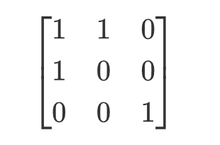
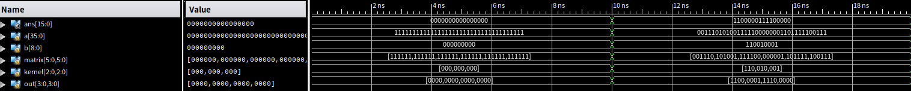
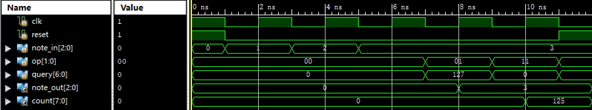
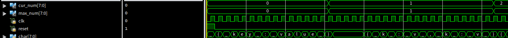

# BUAA CO 2025 P1

## P1_CNNX-异或卷积

### 1、简介

给出一个位宽为 $36$ 的输入 $a$，代表一个 $6\times 6$ 的矩阵。再给出一个位宽为 $9$ 的输入 $b$，代表一个 $3\times 3$ 的卷积核。请你输出一个位宽为 $16$ 的输出 $ans$，代表卷积后的 $4\times 4$ 的矩阵。

将位宽为 $n^2$ 的数据转换成 $n\times n$ 矩阵的规则为：将数据从低位到高位依次填入矩阵，先填满第 0 行，再填满第 1 行，以此类推。从矩阵转换成数据的规则相同。

精确定义：矩阵第 $i$ 行、第 $j$ 列的元素 $M[i][j]$（行列均从 $0$ 开始计数）的值，等于数据 $a$ 的第 $i\times n+j$ 位。数学公式表达为：

$$
M[i][j]=a_{i\times n+j}
$$

例如：给定输入 $a$ = `9'b110100001`，则其对应的矩阵为：



卷积操作是指，对于输出矩阵中的每一个元素 $ans[i][j]$（其中 $0\leq i,j\leq 3$），其值由输入矩阵 $a$ 中以 $a[i][j]$ 为左上角的 $3\times 3$ 子矩阵与卷积核 $b$ 计算得出。

计算方法为：将该 $3\times 3$ 子矩阵与卷积核的对应元素逐个进行 **逻辑与（AND）**，然后将得到的 $9$ 个结果进行 **异或（XOR）** 运算，得到最终的 $1$ 位结果 $ans[i][j]$。用公式表达为：

$$
ans[i][j]=\bigoplus_{k=0}^{2}\bigoplus_{l=0}^{2}\left(a[i+k][j+l]\wedge b[k][l]\right)
$$

其中 $\wedge$ 表示与运算，$\oplus$ 表示异或运算。

最后输出一维的 $ans$，其与二维矩阵的转化规则为：

$$
ans_{i\times 4+j}=ans[i][j]
$$

### 2、模块规格

模块名：CNNX

| 信号名 | 方向 | 描述 |
| --- | --- | --- |
| `a[35:0]` | I | 用于卷积的矩阵 |
| `b[8:0]` | I | 卷积核 |
| `ans[15:0]` | O | 卷积结果 |

### 3、输入输出样例



如图，当 `a = 36'hfffffffff` ，`b = 9'h000` 时，`ans = 16'h0000` 。

当 `a = 36'h3a9f01be7` ，`b = 9'h191` 时，`ans = 16'hc1e0` 。

### 4、提交要求

- 必须严格按照模块的端口名称和方向定义。
- 文件内模块名： CNNX
- 模块内不要包含任何 `$display` 语句，以防造成误判。

## P1_note_recorder-音符记录器

### 1、简介

你需要设计一个简单的音符记录器。这个记录器可以存储最近的 $128$ 个音符（位置为 $0$ 至 $127$），并能根据指令对这些音符进行分析和处理。

我们用数字 $0$ 至 $7$ 表示不同的音符（$0$ 表示休止符，$1$ 至 $7$ 分别表示 `do-re-mi-fa-sol-la-si`）。记录器需要能够添加新音符、查询特定位置的音符，以及计算特定音符的出现次数。

### 2、功能说明

同步复位操作：清空所有存储的音符记录（设为 `3'd0`），`note_out` 和 `count` 也置零。

当 `reset = 1` 时，在时钟上升沿执行复位，优先于其他操作。当 `reset = 0` 时，每当时钟上升沿到达：

1. 添加音符（`op` 为 `2'b00`）：所有已记录的音符位置前移 $1$ 位（原位置 $i+1$ 的音符移至位置 $i$），位置为 $0$ 的音符被丢弃，将 `note_in` 添加到位置为 $127$ 的地方，输出保持不变。初始状态下所有位置都是休止符。
2. 查询音符（`op` 为 `2'b01`）：将 `query` 位置的音符值输出到 `note_out`，`count` 保持不变，存储的音符不变。
3. 统计音符（`op` 为 `2'b11`）：统计当前存储的 $128$ 个音符中，值等于 `query[2:0]` 的音符个数，结果输出到 `count`，`note_out` 保持不变，存储的音符不变。统计时忽略 `query[6:3]`。
4. 无效操作（`op` 为 `2'b10`）：存储的音符及两个输出均保持不变。

### 3、模块规格

模块名：note_recorder

| 信号名 | 方向 | 描述 |
| --- | --- | --- |
| `clk` | I | 时钟信号 |
| `reset` | I | 同步复位信号，高电平有效 |
| `note_in[2:0]` | I | 输入的音符值 |
| `op[1:0]` | I | 操作码 |
| `query[6:0]` | I | 查询位置或要统计的音符值 |
| `note_out[2:0]` | O | 查询操作的输出音符值 |
| `count[7:0]` | O | 统计操作的输出计数值 |

### 4、输入输出样例



1. 时钟周期 1 复位后，所有存储单元为 `3'd0`，`note_out = 0`，`count = 0`。
2. 如图，添加音符：

- 时钟周期 2：`note_in = 3'd1`，`op = 2'b00`（添加音符 do）
- 时钟周期 3：`note_in = 3'd2`，`op = 2'b00`（添加音符 re）
- 时钟周期 4：`note_in = 3'd3`，`op = 2'b00`（添加音符 mi）
- 此时按位置 $0$ 至 $127$ 排列的序列为 `[0, ..., 0, 1, 2, 3]`（共 $125$ 个零）

3. 查询操作：

- 时钟周期 5：`query = 7'd127`，`op = 2'b01`（查询最新添加的音符）
- 同一时钟周期，`note_out = 3'd3`

4. 统计操作：

- 时钟周期6：`query = 7'd0`，`op = 2'b11`（统计休止符个数）
- 同一时钟周期，`count = 8'd125`

### 5、提交要求

- 必须严格按照模块的端口名称和方向定义。
- 文件内模块名：note_recorder。
- 模块内不要包含任何 `$display` 语句，以防造成误判。

## P1_json-序列检验

### 1、题目简介

你需要设计一个 Moore 型状态机对一个 json 序列进行有效性检测并统计键值对数量。每个周期内，串行输入 json 序列的一个字符，你需要根据现有的输入来决定输出并在下个时钟上升沿更新。

#### json 介绍

具体的，对于一个示例 json 序列：

```
{   
    "key1": "value1",
    "key2": "value2",
    "key3": "value3"
}
```

我们会将该 json 序列集中在一行，同时去掉所有空白字符，形如下文：

```
{"key1":"value1","key2":"value2","key3":"value3"}
```

然后每个周期以 ASCII 码的形式输入该 json 序列的一个字符。

比如：第 $0$ 周期输入左大括号 `{` 。第 $1$ 周期输入左双引号 `"` 。第 $2$ 周期输入字符 `k` …… 以此类推

对于所有输入的 json 序列，都满足以下格式规范：

- 每个 json 序列以左大括号 “{“ 为开始，以右大括号 “}” 为结束。内部不包含嵌套大括号。
- 每个 json 序列内部由不定组键值对组成，每组键值对之间用逗号 “,” 隔开。可以没有键值对，也可以有多组键值对。最多包含 $255$ 组键值对。
- 键值对的格式严格符合 `"key":"value"` 。其中内部的 key 和 value 可被替换且至少有一个字符（不为空字符串），例如 `"test":"CO"` 。字符串由大小写字母和数字组成，不包含嵌套双引号，长度最多为 $15$ 个字符。
- 相邻两个 json 序列间用若干个空格隔开（可以没有空格）。例如 `{"fruit":"apple"} {}{"animal":"cat"}`。

#### 输出介绍

输出包括两个 $8$ 位的变量 `cur_num`、`max_num`。在初始状态或 `reset` 后均为 `8'd0` 。

- `cur_num`：输出当前 json 序列的键值对数目。具体的，在每个 json 序列输入完毕的下一个时钟上升沿更新该 json 序列中的键值对数目。例如，对于输入 `{"k1":"v1","k2":"v2"}` ，该 json 序列含有 $2$ 组键值对，**若当前周期输入了右大括号 “}”**，则在下一个时钟上升沿更新 `cur_num` 为 `8'd2`，之后 `cur_num` 将一直不变直到 `reset` 或 下一个 json 序列输入完毕。
- `max_num`：输出历史输入的 json 序列的键值对数目的最大值。具体的，每次 `cur_num` 更新时，同步更新 `max_num` 为历史所有 `cur_num` 中的最大值。例如，对于输入 `{"k":"v"} {"k1":"v1","k2":"v2"}{}` ，在第一个 json 序列的右大括号输入后，下一个周期 `cur_num = 8'd1 , max_num = 8'd1` 。在第二个 json 序列的右大括号输入后，下一个周期 `cur_num = 8'd2 , max_num = 8'd2` 。在第三个 json 序列的右大括号输入后，下一个周期 `cur_num = 8'd0 , max_num = 8'd2` 。**当 `reset` 后，清空所有 json 序列历史记录。**

#### 特别情况

- 正常情况下 json 序列键值对中的字符串不为空，即至少有一个字符。
- **若 json 序列键值对中的字符串出现空串，即 `{"":"value"}` 或 `{"key":""}` ，则该 json 序列为无效序列，其 `cur_num` 视为 `8'd0` 。** json 序列为有效序列当且仅当内部所有键值对的字符串都不是空串。
- 除了上述情况外，不会出现其他非法情况。即输入的 json 序列只有两种：1. 合法 json 序列，所有键值对的字符串均不为空串。 2. 无效 json 序列，至少有一个字符串是空串。
- 保证在每个 json 序列输入的过程中不会出现 `reset`，即 `reset` 只可能会在 json 序列之间的间隙出现。
- **判断输入是否等于双引号时，请使用：`char == 8'h22`** 
- 

### 2、模块规格

模块名：json

| 信号名 | 方向 | 描述 |
| --- | --- | --- |
| `clk` | I | 时钟信号 |
| `reset` | I | **异步**复位信号 |
| `char[7:0]` | I | 串行输入的字符 ASCII 码 |
| `cur_num[7:0]` | O | 当前 json 序列的键值对数目 |
| `max_num[7:0]` | O | 历史 json 序列的最多键值对数目 |

### 3、输入输出样例



如图，当输入为 `{"key":"value"} {"k":"v","k":"v"}` 时，在第一个 json 序列输入完后，`cur_num = 1, max_num = 1` 。当第二个 json 序列输入完后，`cur_num = 2, max_num = 2` 。

### 4、提交要求

- 必须严格按照模块的端口名称和方向定义。
- 文件内模块名： json
- 模块内不要包含任何 `$display` 语句，以防造成误判。